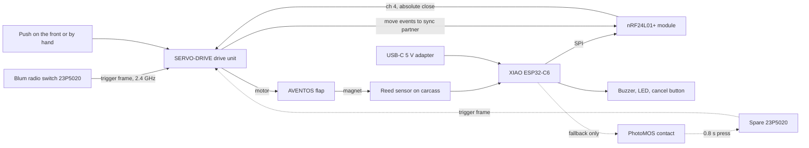
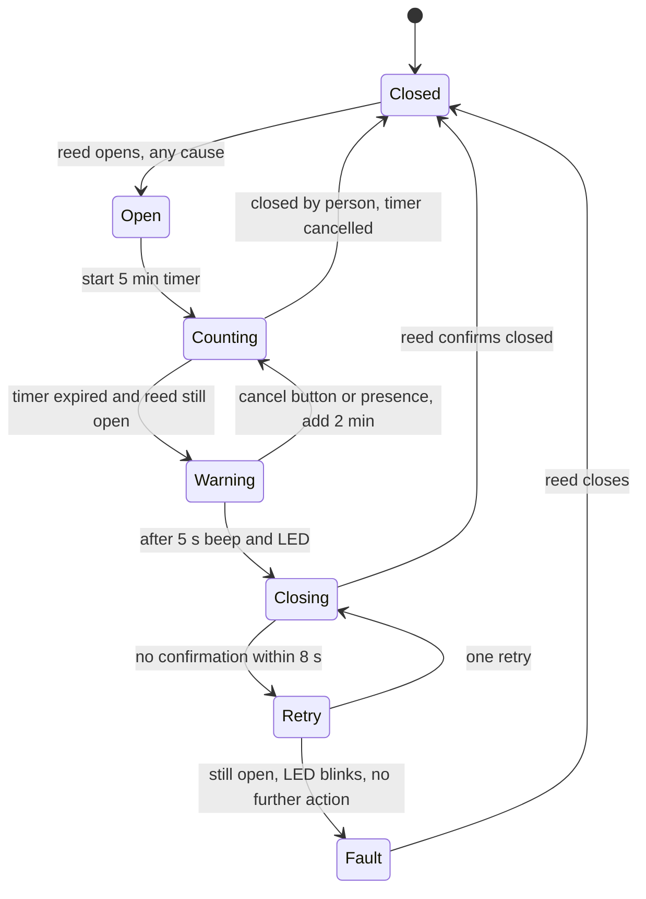

# Aventos Auto-Close Plan (draft 1.1, 2026-11-05)

Goal: an ESP32 device that notices when the Blum AVENTOS flap (SERVO-DRIVE) has been opened and sends a close command five minutes later. Phases: (1) research, (2) design a system that reads and sends the signal, (3) OpenSCAD enclosure.

Status: draft for validation by the owner. The interactive version of this plan is the published artifact "Aventos Auto-Close Plan". Research outcome: `research/README.md` (index and condensed findings), `research/verification.md` (claim-by-claim verdicts), `research/raw/` (per-angle findings with evidence and negative results), `research/research-report.md` (full synthesis, written by the background workflow). A standalone copy of the plan page: `research/aventos-auto-close-plan.html`.

## Your system: AVENTOS HF top

Top-generation drive unit 23.A000 (set) / 23.A001 (unit), FCC ID W95-23A001, EU since 2023, buttons Link / Ok / Play / Collision / Reset. Linking switches: Link, press each switch, Ok (up to 6 per drive). Synchronising drives: Link on both drives, Ok, Play for the reference run (up to 3). Reset restores factory settings (re-link switches afterwards). This is the generation the open-source library has not been tested on, so gate G1 carries real risk; order the spare switch together with the spike parts (D10).

Bluetooth? No evidence on the switch-to-drive link. The "simple bluetooth connection" wording is a US retailer bullet (McFadden's), not Blum's. Blum gives the 23.A00x drive the same radio data as the switch (2.404–2.452 GHz, +4 dBm, bidirectional coded telegrams), declares it under EN 300 440 (not EN 300 328, the Bluetooth standard), and that band does not cover the 2402–2480 MHz a Bluetooth radio must use. FCC: drive W95-23A001 = Part 15.249 transmitter 2404–2452 MHz; switch W95-23P502L00-01 = "2.4 GHz proprietary, GFSK". An undocumented Bluetooth interface for a future app is possible; a BLE scan from the ESP32-C6 in Stage 1 settles it.

## Recommendation

Hybrid, staged device:

- Seeed XIAO ESP32-C6 + genuine Nordic nRF24L01+ joins the drive as a virtual synchronised drive over Blum's own 2.4 GHz link (open-source library Port-Net/BlumServoDrive), sends an absolute close (idempotent) and receives the drive's move events.
- Reed sensor on the flap as ground truth and safety interlock. It starts the timer for every kind of opening, including a push on the front, which produces no radio frame from the switch.
- If the radio path fails gate G1 on the owner's drive generation, the same box drives a spare Blum switch 23P5020 through an isolated PhotoMOS contact (proven by prior art).

Why not "catch the switch's OPEN frame" alone: the switch sends a trigger only; the drive decides open or close from its own position; and the normal way to open an AVENTOS flap is a push on the front, which never involves the switch.

## What the research established

Legend: [confirmed] quoted from a primary source and checked by an independent verifier; [uncertain] plausible, not proven; [corrected] partly wrong in the first pass, fixed; [inferred] engineering inference.

1. [confirmed] All current SERVO-DRIVE radio parts (switch 23P5020, drives 21FA00x / 23.A00x / 23KA00x, flex receiver): 2.404–2.452 GHz, max +4 dBm, ~10 m, "bidirectional, coded telegrams", declared under EN 300 440. (Blum BA-139 v7; EU DoCs.)
2. [confirmed] Link = Nordic Enhanced ShockBurst (nRF24L01+): GFSK 1 Mbps, channel 4 (2404 MHz) operation, channel 10 (2410 MHz) sync pairing, 5-byte addresses 0xDD + reversed 3-byte ID + pipe byte, dynamic payloads, auto-ACK with ACK payloads, CRC-16. ESP32's own radio cannot speak it: external nRF24L01+ or nRF52840 required. RF chip never photographed. (Port-Net code; bluhm-de; Nordic spec; Blum patents.)
3. [confirmed] Port-Net/BlumServoDrive (ESP32 + RF24): pairs via the drive's SYNC procedure as a virtual synced drive, learns the drive ID, sends absolute open/close (0x25 wake + 0x26 move), fires OPEN/CLOSE callbacks on drive move frames. Caveats: single author, last commit 2025-01-10, no documented hardware or drive generation; open/close byte (0x01/0x10) mapped inconsistently between send and receive paths; four small bugs; LICENSE GPL-2.0 vs metadata LGPL-3.0.
4. [uncertain] Whether a sync partner is told about every movement, including front-press openings, is untested. Stage 1 must measure it.
5. [confirmed] The switch sends a trigger only (fixed command, switch ID, counter; no open/close field). The drive picks the direction. Counter not checked on the analysed generation (no rolling code). (Patent DE202009010203U1; bluhm-de; Port-Net.)
6. [confirmed] A brief push on the front (≈2 mm bumper travel) opens the flap; the flap can be moved by hand at any time; neither produces a switch frame.
7. [confirmed] No wired control input on any AVENTOS drive; only the two-core 24 V DC SELV power lead. Blum forbids other loads on its power supply → separate USB-C supply.
8. [corrected] Up to six switches per drive, documented for classic and HK top drives; each switch binds to one drive; Reset Wireless/reset erases all pairings and sync/collision settings. Spare 23P5020 ≈ €29–38 (DE/AT).
9. [uncertain] Switch internals: CR2032, 10 mA rated, PCB 23P502L00.01. Pad names (+3 V, GND, button to MCU, button to Vcc "maybe 1.8 V") are a blogger's annotations. Proven: 3.3 V feed + floating contact 0.8 s toggles an HK top flap. Lean protection ignores long presses.
10. [confirmed] Collision detection stops opening and closing on contact, even just after a close command. After a power cut the flap stays put; next switch press re-activates. Duty S3 5 %, max 10 moves per 10 min. LEDs only, no beeper.
11. [confirmed] No Blum timer, auto-close, app or API. Only SERVO-DRIVE flex has a 2.5/4/8 s hold-open.
12. [confirmed] Drive families: 21FA00x classic HF/HS/HL (buttons SWITCH/SYNC/COLL/Reset Motion/Reset Wireless), 23KA00x HK top, 23.A00x HF/HS/HL top (EU 2023; buttons Connect/OK/Play). Label on the left lift mechanism: article number, BAU serial, FCC ID. Blum updated the electronics in September 2025; the 2020 patent family describes optional encryption/time windows. Library pairing flow matches the classic SYNC buttons; top generation untested.
13. [uncertain] nRF24L01+ clones (Si24R1, BK2425/RFM7x, XN297) reportedly fail the ACK-payload/dynamic-payload exchange. Buy genuine Nordic parts, test two sources.
14. [confirmed] Library example pins match the XIAO ESP32-C6 exactly (CSN D0, CE D1, SPI D8/D9/D10, BOOT = pairing). XIAO ESP32-C3 works with a CSN pull-up or pin remap (MISO = GPIO9 strapping pin). Needs arduino-esp32 3.x; RF24 1.6.x masks IRQ by default.
15. [confirmed] Legal: EU 10 mW e.i.r.p. (ERC/REC 70-03 band i, EN 300 440); FCC 15.249. Plain nRF24L01+ with PCB antenna is fine; no PA+LNA.
16. [inferred] Wi-Fi channel 1 overlaps 2404/2410 MHz. Standalone first; if Wi-Fi, router on channel 6+, separate antennas in the case.
17. [confirmed] Prior art: daumemo (Z-Wave + modified switch + reed, HK top, 2026-02), bluhm-de protocol page (2023, addresses paywalled), Shelly Uni plan (2025-01, unbuilt). Nothing in ESPHome, HA core, rtl_433, Flipper or URH.
18. [confirmed] Enclosure: YAPP_Box (MIT) parametric generator; NopSCADlib XIAO model; PLA/PETG < 0.01 dB at 2.4 GHz; ≥ 15 mm antenna clearance from metal; ≥ 30 mm from the Blum PSU; cables away from moving parts.
19. [confirmed] No Blum document mentions Bluetooth for SERVO-DRIVE for AVENTOS; the HF/HS/HL top drive is declared under EN 300 440 with the same 2.404–2.452 GHz data as the switch; the only "Bluetooth" mention is a retailer bullet. (Blum BA-139 v7; DoC 23.A000/23.A001 2023-09-06; FCC records; McFadden's listing.)

## Architecture

Components: XIAO ESP32-C6 (Arduino/PlatformIO, arduino-esp32 3.x, patched fork of the library); genuine nRF24L01+ with PCB antenna + 10 µF/100 nF at the pins, on the XIAO 3V3 rail; reed on the carcass bottom front edge with a flush magnet in the flap (fail-safe wiring: broken cable reads "not closed, do nothing"); piezo buzzer + LED + one tactile button (cancel/postpone, long press = pairing); fallback header: PhotoMOS AQY212EH + 330 Ω from a boot-quiet GPIO across the spare switch's button pads (spare keeps its CR2032); power: any 5 V USB-C adapter.

## Options compared

| Criterion | A · Radio only | B · Spare switch + reed | C · Hybrid, staged (recommended) |
|---|---|---|---|
| Detects a front-press opening | Maybe (untested relay) | Yes, reed | Yes, reed always; radio events as bonus |
| Modifies Blum hardware | No (uses 1 of 3 sync slots) | Yes (spare switch opened) | No, unless fallback |
| Close command | Absolute, idempotent | Toggle, needs state | Absolute; toggle only as gated fallback |
| Generation risk | High | Low | Low |
| Parts cost | ≈ €35 | ≈ €65 | €35, +€30 if fallback |
| Matches "catch the signal, send a signal" | Yes | Partly | Yes |
| Main failure mode | Drive rejects pairing / no relay | Phantom press opens a closed flap | Each mitigated |

Discarded: servo/SwitchBot pusher, 24 V current sensing, accelerometer on the front (fails on HL), replacing Blum's electronics.

## Stages and gates

0. **Identify and observe** (at home, ~1 h, €0): label photos, four quick tests, reed placement, power socket, decisions D1–D9. Gate G0: drive generation and switch part number known, decisions answered.
1. **Radio feasibility spike** (1–2 evenings, ~€20): breadboard XIAO ESP32-C6 + genuine nRF24L01+ + 10 µF; fork the library, fix its four bugs, enable debug; on the HF top drive press Link, start the library's sync routine within its 20 s window, watch for the drive's acknowledgement on channel 10, press Play if the drive expects the reference run and log everything; run a BLE scan from the C6 while the drive is in Link mode; log frames while pressing the switch to close and to open, pushing the front, moving by hand; send one absolute close with the flap open and one with it closed. Gate G1: pairing succeeds; drive-originated move frame seen for switch-triggered moves; absolute close works and is harmless on a closed flap. Bonus: front-press moves relayed. No-go → fallback: spare 23P5020 linked to the drive (Link, press switch, Ok) and wired to the PhotoMOS header. Reed stays in both cases. HF top is the untested generation: order the spare with the spike parts (D10).
2. **Device build and soak** (2–3 weekends, ~€15): firmware state machine, adjustable delay (default 5 min), reed debounce, warning, cancel, rate limit (1 close/min, ≤10 moves/10 min), boot-quiet outputs, watchdog, optional MQTT/HA; bench test, install, one-week logged soak. Gate G2: 20 consecutive correct closes, 0 unintended openings, 0 phantom presses across 10 power cycles, one deliberate obstruction handled by retry/fault.
3. **OpenSCAD enclosure** (1 weekend, ~€5): YAPP_Box project box, XIAO standoffs, nRF24 slot with antenna clear of walls/metal, USB-C cutout, LED light tube, button cap, reed strain relief, M2 heat-set inserts (3.2 mm holes), VHB tape or screws; NopSCADlib fit check; PETG; ≥ 30 mm from the Blum PSU. Gate G3: case closes without antenna pressure, reed cable captive, device re-passes G2 in the case.

## Bill of materials (EU, Nov 2026)

| Item | Qty | Price | Note |
|---|---|---|---|
| Seeed XIAO ESP32-C6 | 1 | €8.50 | C3 (€7.90) works with pin remap + CSN pull-up |
| nRF24L01+ module, PCB antenna, genuine Nordic | 2–3 | €8 (3-pack) | clone risk; test two batches |
| 10 µF electrolytic + 100 nF ceramic | 1 each | €0.50 | at module pins |
| Reed switch + magnet | 1 set | €2 | actuates 15–25 mm |
| Piezo buzzer, LED, 330 Ω, tactile button | 1 set | €2 | |
| PhotoMOS AQY212EH + 330 Ω | 1 | €2 | fallback header |
| Wires, headers, perfboard | — | €3 | |
| USB-C 5 V adapter + cable | 1 | €8 | dedicated supply |
| PETG, M2 inserts, VHB tape | — | €5 | stage 3 |
| **Core total** | | **≈ €39** | |
| Blum switch 23P5020 (fallback only) | 1 | €29–38 | up-to-sixth switch; original untouched |
| Optional LD2410 presence sensor | 1 | €5 | postpones closing |
| Optional Nordic nRF52840 dongle | 1 | €12 | passive ESB analyser; no RTL-SDR (cannot tune 2.4 GHz) |

## Safety and robustness

- Blum stays in charge of the motion: collision detection active; the device never holds a button; ≤ 1 close per minute, within 10 moves/10 min.
- 5 s beep + LED before any unattended close; button postpones 2 min; optional presence veto.
- Never close blind: close only while the reed reports open; radio path sends an absolute close; fallback toggle gated by the same check.
- Confirm, retry once, then latch a fault (blinking LED) until a person closes the flap. Same path when collision detection stops the flap.
- Power-up discipline: boot-quiet output pins with pull-downs, 60 s hold-off, reed read before any decision; never fake the switch press the drive needs after a mains cut.
- Master off: the switched outlet Blum recommends for its PSU.
- Children/pets: warning, cancel, presence option, optional night window.

## Decisions for the owner

- D1 Approach: **C hybrid, staged** (recommended) / A radio only / B spare switch + reed.
- D2 Timer start: **any opening the reed sees** (recommended) / only radio-detected moves.
- D3 Countdown behaviour: **close by person cancels, re-open restarts** (recommended) / timer continues.
- D4 Board: **XIAO ESP32-C6** (recommended) / XIAO ESP32-C3 / a board already owned.
- D5 Power: **USB-C adapter** (recommended) / battery (fallback build only).
- D6 Connectivity: **standalone first, MQTT/HA later** (recommended) / HA from day one via ESPHome external component.
- D7 Safety set: **warning + cancel + one retry then fault** (recommended); optional LD2410 veto; optional night window.
- D8 Delay: **5 min default, adjustable 1–30 min** (recommended) / fixed.
- D9 Licence: keep MIT while private / **GPL-2.0-or-later before publishing firmware** that links RF24 and Port-Net code (recommended).
- D10 Spare switch timing (HF top): **order the spare 23P5020 with the Stage 1 parts** (recommended) / wait for G1.

## Home checks before Stage 1

1. Photo of the drive label (left lift mechanism): article number 21FA…/23.A…/23KA…, BAU serial, FCC ID.
2. Photo of the drive buttons to confirm the top layout (Link / Ok / Play / Collision / Reset).
3. Back of the switch: 21P5020 or 23P5020, one LED or two, FCC ID; number of paired switches.
4. Lift type: AVENTOS HF top (known). Synced or collision-linked with neighbours? How many drives?
5. Purchase/installation date (before/after Sept 2025), country.
6. Test 1: flap closed, press the switch: does it open?
7. Test 2: press the switch during opening, then during closing: stop, reverse, ignored?
8. Test 3: flap open, hold the switch 2–3 s: ignored?
9. Test 4: push the front to open, close by hand: any drive LED reaction?
10. Reed placement: room on the carcass bottom front edge; flush magnet spot in the flap; materials.
11. PSU label (Z10NE0…/Z10NA…) and a free socket/USB near the cabinet.
12. Tools and parts on hand (soldering iron, 3D printer, boards, nRF24 modules, PlatformIO/Arduino).
13. Home Assistant present? Router 2.4 GHz channel?

## Risks

| Risk | Likelihood | Mitigation |
|---|---|---|
| Library does not pair with top/post-2025 drive | high (HF top is that generation) | G1 decides early; spare-switch fallback |
| Front-press openings not relayed | medium | reed starts the timer regardless |
| Open/close byte mapped the wrong way | medium | calibrate in Stage 1; reed gate |
| Clone nRF24 fails ACK payloads | medium | genuine Nordic parts, two sources |
| Sync slot used; Reset Wireless unpairs everything | low | document re-pairing |
| Wi-Fi interference on ch 4/10 | low | standalone first; router ch 6+; antenna separation |
| Unattended close on a person/object | low | collision detection, warning, cancel, presence, retry-then-fault |
| Duty rating exceeded | low | rate limit |
| Phantom press after reboot (fallback) | low | boot-quiet GPIO, self-ending pulse, hold-off |
| Warranty on an opened spare switch | certain if fallback | only the spare is modified |

## Sources

- Blum BA-139 v7 (EN): https://d2.blum.com/services/BEC003/kla0031-ba-139_ba_dok_bau_$sen_$aof_$v7.pdf
- Blum SERVO-DRIVE for AVENTOS programme: https://www.blum.com/eu/en/products/motion-technologies/servo-drive/servo-drive-aventos/programme/
- Blum troubleshooting: https://www.blum.com/us/en/landingpages/products/servo-drive/troubleshooting/
- Port-Net/BlumServoDrive: https://github.com/Port-Net/BlumServoDrive
- bluhm-de protocol page: https://www.bluhm-de.com/content/os-tools/en/projects/home-information-system/blum-servodrive-wireless-protocol-deciphered.html
- daumemo build: https://daumemo.com/how-do-you-connect-a-blum-servo-drive-to-z-wave-home-assistant-system/ (enclosure: https://www.thingiverse.com/thing:7293224)
- Shelly forum plan: https://shelly-forum.com/thread/27978-blum-servodrive-mit-shelly-uni-steuern/
- FCC: https://device.report/julius-blum/23p502l00 , https://fccid.io/W95-23A00L83
- Patents: https://patents.google.com/patent/DE202009010203U1 , https://patents.google.com/patent/US12698670B2/en
- Nordic ESB: https://nrfconnectdocs.nordicsemi.com/ncs/latest/nrf/protocols/esb/index.html
- RF24: https://github.com/nRF24/RF24 ; nrf_to_nrf: https://github.com/TMRh20/nrf_to_nrf
- XIAO ESP32-C6: https://wiki.seeedstudio.com/xiao_esp32c6_getting_started/ ; XIAO ESP32-C3: https://wiki.seeedstudio.com/XIAO_ESP32C3_Getting_Started/
- YAPP_Box: https://github.com/mrWheel/YAPP_Box
- Spare switch price: https://www.lignoshop.de/23p5020-servo-drive-schalter-weiss.html
- Regulatory: ERC/REC 70-03 Annex 1 band i; 47 CFR 15.249; IEC 60335-2-116:2025; Blum DoC 23.A000/23.A001 (EN 60335-1, EN ISO 14118).
